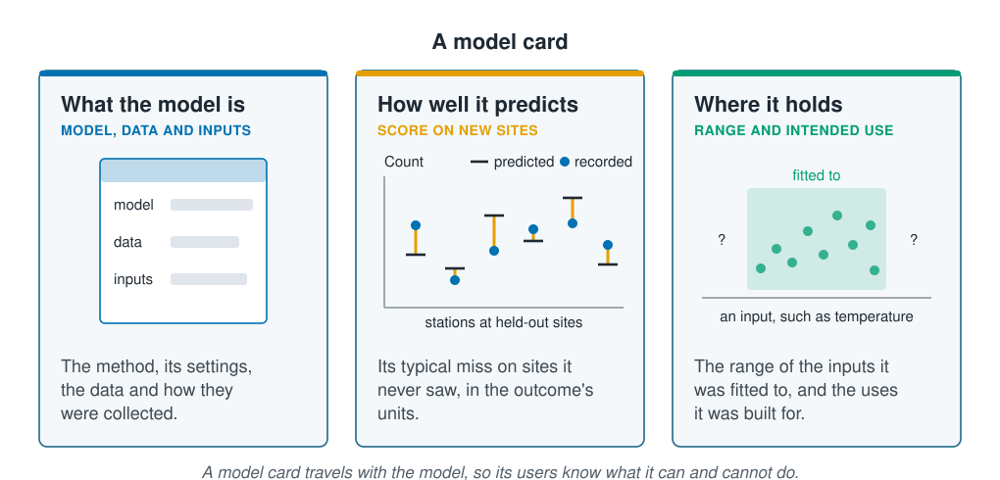

```{r}
#| label: setup
#| include: false
library(tidymodels)
library(tidyverse)
source(here::here("R/theme.R"))
source(here::here("R/data.R"))
source(here::here("R/python-tabs.R"))
set.seed(123)
```



## A report lets others re-run a model and use it

A fitted model reaches two kinds of reader. One wants to check the numbers: to run the
same code on the same data and see the same results. The other wants to use the
predictions, and needs to know what the model was built for and where it can be
trusted. This page covers both: the habits that let anyone re-run an analysis, and a
short, fixed set of entries, the model card, that goes with the model wherever its
predictions are used.





## A re-runnable analysis keeps four things

An analysis is **reproducible** when someone else, given the same data and the same
code, gets the same numbers. A reader can then check a result, and you can return to
your own analysis a year later and pick up where you left off. Four things make it so.

::: {.diagram}
{fig-alt="Four cards. The raw data, kept as collected: the file as it came in, never edited by hand, drawn as a locked table. Every step in code, in scripts: from the raw file to the score, cleaning, fitting and scoring, drawn as four boxes, raw, clean, model and score, joined by arrows. A seed above each draw, for random choices: set just before the draw it is for, so each step gets the same draws every run, drawn as two runs from seed 1 giving the same three numbers. The software versions, in a lockfile: each package and its version, so a reader can install the same ones, drawn as a table of packages A, B and C with their versions. A note says that with all four anyone can re-run the analysis and get the same numbers."}
:::

This course keeps all four. The survey's raw file, `data/coastal-survey-raw.csv`, is
never edited; `load_coastal_survey_clean()` turns it into the clean survey in code,
dropping duplicate rows, turning missing-value codes into gaps, correcting depth errors
and merging the spellings of the seabed. `renv.lock` records the version of every R
package, and `renv::restore()` installs the same versions; in Python,
`pip freeze > requirements.txt` records them. And every number in the text of these
pages is computed by the page's own code, not typed, so the text cannot quote a number
the code no longer gives. A report written as a Quarto or R Markdown document works the
same way.

The seed needs the most care. A split, a random forest and a shuffle all draw from a
random number generator, and a **seed** sets where its sequence of numbers starts. It
does not fix which step gets which number. An extra draw before the split, even one
hidden inside another function, shifts every draw after it, and the worked example
shows one.

## A model card says what a model is for and where it holds

A **model card** is a short document that travels with a model. The idea comes from
machine learning in general (Mitchell and colleagues, 2019), and the entries suit a
model of survey data well:

| Entry | Says | Comes from |
| --- | --- | --- |
| Model | The method, its package and version, and its settings | The code |
| Intended use | What the predictions are for, and what they are not for | The study's aim |
| Data | Where the records come from, how many stations and sites, and how they were caught | [Exploring and cleaning the data](../02-marine-data/exploring-and-cleaning.qmd) |
| Inputs | What the model predicts from, and how gaps were filled | The recipe |
| Score | Its typical miss on sites it never saw | [The test sites](../02-marine-data/splitting-data.qmd) |
| What it relies on | The inputs it uses most, and the shape of its strongest effect | [Feature importance](feature-importance.qmd), [Partial effects](partial-effects.qmd) |
| Where it holds | The range of each input it was fitted to | The training stations |
| Limits | What the predictions cannot say | [Uneven sampling and extrapolation](../06-assumptions-limitations/sampling-and-extrapolation.qmd) |

::: {.diagram}
{fig-alt="Three cards. What the model is, model, data and inputs: the method, its settings, the data and how they were collected, drawn as a form with lines for model, data and inputs. How well it predicts, score on new sites: its typical miss on sites it never saw, in the outcome's units, drawn as six stations at held-out sites, each with a predicted count, a recorded count and the miss between them. Where it holds, range and intended use: the range of the inputs it was fitted to and the uses it was built for, drawn as stations inside a shaded band along an input such as temperature, with question marks on either side. A note says that a model card travels with the model, so its users know what it can and cannot do."}
:::

The card is a record of what has already been measured, not a new analysis. Each entry
is a sentence or two, and each number in it comes from the code, as the worked example
shows.

## Worked example

The random forest of the earlier pages in this section predicts abundance from depth,
temperature, chlorophyll, salinity, substrate and season. It is fitted to the training
sites of the same split and scored on its test sites. The example first breaks a seed
with a hidden draw, then writes the forest's model card from the code.

### Preparing the data

::: {.panel-tabset group="language"}

## R

```{r}
#| label: prepare
survey <- load_coastal_survey_clean()

inputs <- c("depth_m", "temperature_c", "chlorophyll_mg_m3", "salinity_psu",
            "substrate", "season")

split <- group_initial_split(survey, group = site_id, prop = 0.75)
train <- training(split)
test <- testing(split)

forest_recipe <- recipe(reformulate(inputs, "abundance"), data = train) |>
  step_impute_median(all_numeric_predictors())
forest_model <- rand_forest(trees = 500) |>
  set_engine("ranger", seed = 123) |>
  set_mode("regression")
forest <- workflow(forest_recipe, forest_model) |> fit(train)
```

## Python

```{python}
import numpy as np
import pandas as pd
from sklearn.compose import ColumnTransformer
from sklearn.ensemble import RandomForestRegressor
from sklearn.impute import SimpleImputer
from sklearn.inspection import partial_dependence, permutation_importance
from sklearn.metrics import root_mean_squared_error
from sklearn.model_selection import GroupShuffleSplit
from sklearn.pipeline import Pipeline
from sklearn.preprocessing import OneHotEncoder

from mlbasic_data import load_coastal_survey_clean

survey = load_coastal_survey_clean()
sites = survey["site_id"]

grouper = GroupShuffleSplit(n_splits=1, train_size=0.75, random_state=123)
train_rows, test_rows = next(grouper.split(survey, groups=sites))
train = survey.iloc[train_rows].reset_index(drop=True)
test = survey.iloc[test_rows].reset_index(drop=True)

numeric = ["depth_m", "temperature_c", "chlorophyll_mg_m3", "salinity_psu"]
categorical = ["substrate", "season"]
inputs = numeric + categorical

recipe = ColumnTransformer(
    [("numeric", SimpleImputer(strategy="median"), numeric),
     ("categorical", OneHotEncoder(drop="first", sparse_output=False),
      categorical)])
# max_features and min_samples_leaf match ranger's defaults
model = RandomForestRegressor(n_estimators=500, max_features="sqrt",
                              min_samples_leaf=5, random_state=123)
forest = Pipeline([("recipe", recipe), ("model", model)]).fit(
    train[inputs], train["abundance"])
```

:::

### A hidden draw moves a seeded split

The split is drawn twice from the same seed. The second time, a recipe is built between
the seed and the split. In R, `recipe()` and each `step_*()` draw a random ID, so the
recipe takes numbers from the sequence that the split would otherwise have used.

::: {.panel-tabset group="language"}

## R

```{r}
#| label: order
set.seed(123)
first <- group_initial_split(survey, group = site_id, prop = 0.75)

set.seed(123)
depth_recipe <- recipe(abundance ~ depth_m, data = survey) |>
  step_impute_median(all_numeric_predictors())   # draws a random ID
second <- group_initial_split(survey, group = site_id, prop = 0.75)

test_sites <- \(split) unique(testing(split)$site_id)
shared <- length(intersect(test_sites(first), test_sites(second)))

tibble(Run = c("Seed, then split", "Seed, recipe, then split"),
       `Test sites` = c(length(test_sites(first)), length(test_sites(second))),
       `Shared with the first run` = c(length(test_sites(first)), shared))
```

## Python

```{python}
# without its own random_state, a function draws from numpy's global
# generator, which np.random.seed() sets as set.seed() does in R
def unseeded_split():
    grouper = GroupShuffleSplit(n_splits=1, train_size=0.75)
    return next(grouper.split(survey, groups=sites))

np.random.seed(123)
first = unseeded_split()

np.random.seed(123)
extra = np.random.permutation(10)   # one extra draw, as in another function
second = unseeded_split()

def test_sites(split):
    return set(sites.iloc[split[1]])

pd.DataFrame({
    "Run": ["Seed, then split", "Seed, extra draw, then split"],
    "Test sites": [len(test_sites(first)), len(test_sites(second))],
    "Shared with the first run": [
        len(test_sites(first)),
        len(test_sites(first) & test_sites(second))],
})
```

:::

Both runs set the same seed, yet only `r shared` of the first run's
`r length(test_sites(first))` test sites are among the second run's
`r length(test_sites(second))`, and nothing warned. The first run is the split this section's
pages use; the second would have given every page different numbers. Setting the seed
on the line above the draw it is for, as these pages do, keeps each draw where it was.
In scikit-learn, give each function its own `random_state`; its draws then do not depend
on anything that ran before it.

### The model card is written from the code

Every number the card needs is computed here: the forest's typical miss on the test
sites, how far shuffling each input raises it, the temperature at which the partial
dependence peaks, and the range of depth and temperature over the training stations.

::: {.panel-tabset group="language"}

## R

```{r}
#| label: card
test_rmse <- rmse_vec(test$abundance, predict(forest, test)$.pred)

# the rise in test RMSE when an input is shuffled, as in Feature importance
error <- \(d) rmse_vec(d$abundance, predict(forest, d)$.pred)
importance <- map(inputs, \(input) {
  rises <- map_dbl(1:20, \(i) {
    shuffled <- test
    shuffled[[input]] <- sample(shuffled[[input]])
    error(shuffled) - test_rmse
  })
  tibble(input, rise = mean(rises))
}) |>
  list_rbind() |>
  arrange(desc(rise))

# the partial dependence on temperature, as in Partial effects
ends <- quantile(train$temperature_c, c(0.05, 0.95), na.rm = TRUE)
temperature <- map(seq(ends[1], ends[2], length.out = 40), \(level) {
  swept <- mutate(train, temperature_c = level)
  tibble(value = level, .pred = mean(predict(forest, swept)$.pred))
}) |>
  list_rbind()
peak <- temperature$value[which.max(temperature$.pred)]

# the range of each number input over the training stations
ranges <- train |>
  summarise(across(c(depth_m, temperature_c, chlorophyll_mg_m3, salinity_psu),
                   list(low = \(x) min(x, na.rm = TRUE),
                        high = \(x) max(x, na.rm = TRUE))))

importance |> mutate(rise = round(rise, 3))
```

## Python

```{python}
rmse = root_mean_squared_error(test["abundance"], forest.predict(test[inputs]))

# the rise in test RMSE when an input is shuffled, as in Feature importance
shuffled = permutation_importance(
    forest, test[inputs], test["abundance"], n_repeats=20, random_state=123,
    scoring="neg_root_mean_squared_error")
importance = (pd.Series(shuffled.importances_mean, index=inputs)
              .sort_values(ascending=False))

# the partial dependence on temperature, as in Partial effects
curve = partial_dependence(forest, train[inputs], ["temperature_c"],
                           percentiles=(0.05, 0.95), grid_resolution=40)
peak = curve["grid_values"][0][curve["average"][0].argmax()]

low, high = train[numeric].min(), train[numeric].max()

top = ", ".join(importance.index[:3])
print(f"""Model:    random forest of 500 trees, scikit-learn
Data:     {len(survey)} stations at {sites.nunique()} sites, \
{survey['survey_year'].min()}-{survey['survey_year'].max()}
Score:    RMSE {rmse:.2f} animals on {test['site_id'].nunique()} held-out sites
Relies on: {top}; predictions peak at {peak:.1f} °C
Holds for: depth {low['depth_m']:.0f}-{high['depth_m']:.0f} m, \
temperature {low['temperature_c']:.1f}-{high['temperature_c']:.1f} °C""")
```

:::

```{r}
#| label: card-numbers
#| include: false
one <- \(x) format(round(x, 1), nsmall = 1)
two <- \(x) format(round(x, 2), nsmall = 2)
pct <- \(x) scales::percent(x, accuracy = 1)
words <- \(x) knitr::combine_words(x, oxford_comma = FALSE)
input_names <- c(depth_m = "depth", temperature_c = "temperature",
                 chlorophyll_mg_m3 = "chlorophyll", salinity_psu = "salinity",
                 substrate = "substrate", season = "season")
top_three <- input_names[importance$input[1:3]]
salinity_rise <- importance$rise[importance$input == "salinity_psu"]
range_of <- \(input, digits = 0) {
  paste0(format(round(ranges[[paste0(input, "_low")]], digits), nsmall = digits),
         "–",
         format(round(ranges[[paste0(input, "_high")]], digits), nsmall = digits))
}
years <- range(survey$survey_year)
missing_chlorophyll <- mean(is.na(survey$chlorophyll_mg_m3))
```

The card below is written in the page's text with inline code, so each number is the
one the chunk above gives:

| Entry | The forest on the coastal survey |
| ------- | ---------------------------------------- |
| **Model** | A random forest of 500 trees, fitted with ranger `r packageVersion("ranger")` in R `r getRversion()`, with ranger's default settings and seed 123. |
| **Intended use** | Predicting the count of the species at stations on this coast, to plan where to sample. Not for water outside the ranges below, other coasts, or saying why the count changes. |
| **Data** | `r nrow(survey)` stations at `r n_distinct(survey$site_id)` sites, surveyed by `r words(sort(unique(survey$vessel)))` from `r years[1]` to `r years[2]`, cleaned in code from the raw file. Fitted to `r n_distinct(train$site_id)` sites (`r nrow(train)` stations) and scored on the other `r n_distinct(test$site_id)` (`r nrow(test)` stations), held out whole. |
| **Inputs** | Depth, temperature, chlorophyll, salinity, substrate and season. Chlorophyll is missing at `r pct(missing_chlorophyll)` of stations; gaps are filled with the training stations' median. |
| **Score** | An RMSE of `r two(test_rmse)` animals on the held-out sites: a typical miss of about `r round(test_rmse)` animals at a station. |
| **What it relies on** | Shuffling `r words(top_three)` raised the error most. The predictions peak at `r one(peak)`&nbsp;°C and fall in colder and warmer water. |
| **Where it holds** | Depths of `r range_of("depth_m")` m, temperatures of `r range_of("temperature_c", 1)`&nbsp;°C, salinities of `r range_of("salinity_psu", 1)`, in `r words(levels(train$season))`, on `r words(levels(train$substrate))`. |
| **Limits** | The predictions describe how the count varied between the stations sampled, not what causes it. The counts are what the gear caught, so animals the gear misses are missing from the model too. |

The Python tab prints the same entries from its own split. When the data or the code
change, the card changes with them, and it cannot quote a score the model no longer
reaches.

## A card's sentences stay within what the model showed

Each sentence of a card or a report is a **claim**: it puts a result into words, and a
reader takes the words away, not the numbers. A good claim says what was found and how
far it reaches. Three sentences are often written about a model like this one, and the
card supports none of them as they stand:

- **"Temperature drives the count."** The forest predicts the most animals near
  `r one(peak)`&nbsp;°C, across the stations as they were found. Warm stations differ from
  cold ones in more than temperature, and a cause needs an experiment or knowledge of
  the species. The card says the predictions *peak* there.
- **"Warming will reduce the count."** Water warmer than `r one(ranges$temperature_c_high)`&nbsp;°C
  is outside every station the forest was fitted to, and the card's *Where it holds*
  entry ends there.
- **"Salinity has no effect."** Shuffling salinity did not raise the error (its rise
  was `r two(salinity_rise)` animals), so the forest does not rely on it, with these
  other inputs beside it. As [Feature importance](feature-importance.qmd) showed, an input that
  carries the same information as another scores low; it does not show that the input
  has no effect.

Importance scores, partial dependence, SHAP values and surrogates all describe the
model. A claim about the species goes only as far as the model's data reach, and the
card writes that reach down.

## Key points

::: {.key-points}
- An analysis is **reproducible** when the same data and the same code give the same
  numbers. Keep the raw data, every step in code, a seed above each random draw and the
  software versions.
- A **seed** fixes where the random numbers start, not which step gets which. Here one
  hidden draw left only `r shared` of the `r length(test_sites(first))` test sites in
  place. Set the seed on the line above the draw, or give each function its own
  `random_state`.
- A **model card** travels with a model: what it is, what it is for, its data and
  inputs, its score on new sites, what it relies on, where it holds and its limits.
- Written from the code, the card's numbers cannot drift from the analysis: here an RMSE
  of `r two(test_rmse)` animals, a temperature peak at `r one(peak)`&nbsp;°C, and depths of
  `r range_of("depth_m")` m.
- A **claim** stays within the card: a peak in the predictions, not a cause; the
  surveyed range, not warmer water; a low score, not no effect.
:::

## Try it yourself

1. In the hidden-draw chunk, move the `recipe()` line above the second `set.seed()`.
   Do the two runs now share all their test sites?
2. Write the card for the GAM of
   [Interpretable models and surrogates](interpretable-models.qmd). Which entries change,
   and what can its *What it relies on* entry say that the forest's cannot?
