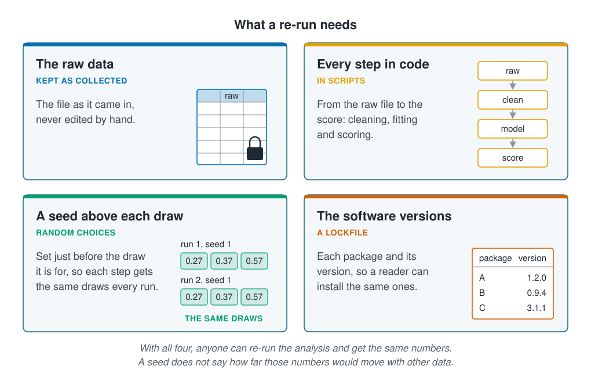

```{r}
#| label: setup
#| include: false
library(tidymodels)
library(tidyverse)
source(here::here("R/theme.R"))
source(here::here("R/data.R"))
source(here::here("R/python-tabs.R"))
set.seed(123)
```

## A re-run should give the same numbers

An analysis is **reproducible** when someone else, given the same data and the same code,
gets the same numbers. A reader can then check a result, and you can return to your own
analysis a year later and pick up where you left off. Most of this comes from a few working
habits, set out at the end of this page. Machine learning adds one more thing to handle:
the random numbers it draws along the way. This page measures which random choice moves a
score most, and lists what a report needs for a reader to re-run the analysis.





## An analysis draws random numbers in several places

A machine-learning analysis draws random numbers at several steps:

- the **split**, which sites are held out to test the model;
- the **folds** of cross-validation, which sites go into each fold;
- the **model's own random choices**: a random forest draws stations and inputs for each
  tree, and a neural network starts from random weights;
- the shuffles that measure each input's score in
  [Feature importance](feature-importance.qmd).

All of them come from a random number generator, which gives the same sequence of numbers
whenever it starts from the same **seed**. Setting a seed makes the whole analysis repeat
exactly. [Checking a fit](../04-how-algorithms-learn/reading-a-fit.qmd) fitted a forest ten
times without one and found that the score moved a little from run to run: a seed hides
that spread rather than removing it. The random choices do not all move a score by the
same amount, and the worked example compares them.

## Worked example

A random forest is scored on the survey in three ways: on one split of the sites, grown
with ten different seeds; on ten different splits, with one seed; and by five-fold
cross-validation by site, with ten different seeds for the folds. Then one seed is broken
by an extra random draw.

### Preparing the data

The forest predicts abundance from depth, temperature, chlorophyll, salinity, the seabed
and the season, with the gaps in chlorophyll filled by the median. `test_rmse()` fits it
to one split's training sites and scores it on the test sites.

::: {.panel-tabset group="language"}

## R

```{r}
#| label: prepare
survey <- load_coastal_survey_clean()

forest_recipe <- recipe(
  abundance ~ depth_m + temperature_c + chlorophyll_mg_m3 + salinity_psu +
    substrate + season,
  data = survey
) |>
  step_impute_median(all_numeric_predictors())

# a random forest whose own random choices start from `seed`
forest <- function(seed) {
  rand_forest(mode = "regression", trees = 300) |>
    set_engine("ranger", seed = seed)
}

# fit to a split's training sites, score on its test sites
test_rmse <- function(split, seed) {
  fitted <- workflow(forest_recipe, forest(seed)) |> fit(training(split))
  rmse_vec(testing(split)$abundance, predict(fitted, testing(split))$.pred)
}

# the lowest, highest and range of each set of scores
spread <- function(...) {
  list(...) |>
    map(\(rmse) tibble(`Lowest RMSE` = min(rmse), `Highest RMSE` = max(rmse),
                       Range = max(rmse) - min(rmse))) |>
    list_rbind(names_to = "Varied") |>
    mutate(across(where(is.double), \(x) round(x, 2)))
}
```

## Python

```{python}
import numpy as np
import pandas as pd
from sklearn.compose import ColumnTransformer
from sklearn.ensemble import RandomForestRegressor
from sklearn.impute import SimpleImputer
from sklearn.metrics import root_mean_squared_error
from sklearn.model_selection import (GroupKFold, GroupShuffleSplit,
                                     cross_val_predict)
from sklearn.pipeline import Pipeline
from sklearn.preprocessing import OneHotEncoder

from mlbasic_data import load_coastal_survey_clean

survey = load_coastal_survey_clean()

numeric = ["depth_m", "temperature_c", "chlorophyll_mg_m3", "salinity_psu"]
categorical = ["substrate", "season"]
X, y = survey[numeric + categorical], survey["abundance"]
sites = survey["site_id"]

forest_recipe = ColumnTransformer([
    ("numeric", SimpleImputer(strategy="median"), numeric),
    ("categorical", OneHotEncoder(sparse_output=False), categorical),
])

# a random forest whose own random choices start from `seed`;
# max_features="sqrt" and min_samples_leaf=5 are ranger's defaults
def forest(seed):
    model = RandomForestRegressor(n_estimators=300, max_features="sqrt",
                                  min_samples_leaf=5, random_state=seed,
                                  n_jobs=-1)
    return Pipeline([("recipe", forest_recipe), ("model", model)])

# a quarter of the sites held out for testing
def site_split(seed):
    grouper = GroupShuffleSplit(n_splits=1, train_size=0.75,
                                random_state=seed)
    return next(grouper.split(X, groups=sites))

# fit to a split's training sites, score on its test sites
def test_rmse(split, seed):
    rows, held = split
    fitted = forest(seed).fit(X.iloc[rows], y.iloc[rows])
    return root_mean_squared_error(y.iloc[held], fitted.predict(X.iloc[held]))

# the lowest, highest and range of each set of scores
def spread(scores):
    return pd.DataFrame([
        {"Varied": name, "Lowest RMSE": rmse.min(),
         "Highest RMSE": rmse.max(), "Range": np.ptp(rmse)}
        for name, rmse in scores.items()]).round(2)
```

:::

### The split of sites moves the score more than the forest's seed

The forest is first grown ten times on one split, with a different seed each time, then
once on each of ten different splits, with the same seed.

::: {.panel-tabset group="language"}

## R

```{r}
#| label: seed-and-split
# one split of the sites, the forest grown with ten different seeds
set.seed(1)
one_split <- group_initial_split(survey, group = site_id, prop = 0.75)
by_seed <- map_dbl(1:10, \(seed) test_rmse(one_split, seed))

# ten different splits, the forest grown with one seed
by_split <- map_dbl(1:10, \(s) {
  set.seed(s)
  test_rmse(group_initial_split(survey, group = site_id, prop = 0.75), 1)
})

spread(`Forest's seed` = by_seed, `Split of sites` = by_split)
```

## Python

```{python}
# one split of the sites, the forest grown with ten different seeds
one_split = site_split(1)
by_seed = np.array([test_rmse(one_split, seed) for seed in range(1, 11)])

# ten different splits, the forest grown with one seed
by_split = np.array([test_rmse(site_split(s), 1) for s in range(1, 11)])

spread({"Forest's seed": by_seed, "Split of sites": by_split})
```

:::

```{r}
#| label: split-numbers
#| include: false
two <- \(x) format(round(x, 2), nsmall = 2)
range_of <- \(x) max(x) - min(x)
```

On one split, the ten seeds gave test RMSEs from `r two(min(by_seed))` to
`r two(max(by_seed))` animals, a range of `r two(range_of(by_seed))`. With one seed, the
ten splits gave `r two(min(by_split))` to `r two(max(by_split))`, a range of
`r two(range_of(by_split))`, about `r round(range_of(by_split) / range_of(by_seed))`
times as much. Which sites happened to be held out decides the score far more than the
forest's seed does. A seeded split repeats its number exactly, but another split could
have put that number anywhere in this range.
[Feature importance](feature-importance.qmd) found the same for the inputs' scores, which
moved from one split to the next.

### Cross-validation steadies the score

Cross-validation scores every site once, while its fold is held out, and pools the
out-of-fold predictions into one score, as on
[Cross-validation](../07-validation/cross-validation.qmd). A new seed puts the sites into
different folds, but every site is still scored.

::: {.panel-tabset group="language"}

## R

```{r}
#| label: folds
# five folds of sites, with ten different seeds for the folds
by_folds <- map_dbl(1:10, \(s) {
  set.seed(s)
  folds <- group_vfold_cv(survey, group = site_id, v = 5)
  scored <- workflow(forest_recipe, forest(1)) |>
    fit_resamples(folds, control = control_resamples(save_pred = TRUE))
  pooled <- collect_predictions(scored)
  rmse_vec(pooled$abundance, pooled$.pred)
})

spread(`Forest's seed` = by_seed, `Split of sites` = by_split,
       `Folds of sites` = by_folds)
```

## Python

```{python}
# five folds of sites, with ten different seeds for the folds
def pooled_rmse(seed):
    folds = GroupKFold(n_splits=5, shuffle=True, random_state=seed)
    pooled = cross_val_predict(forest(1), X, y, groups=sites, cv=folds)
    return root_mean_squared_error(y, pooled)

by_folds = np.array([pooled_rmse(s) for s in range(1, 11)])

spread({"Forest's seed": by_seed, "Split of sites": by_split,
        "Folds of sites": by_folds})
```

:::

The ten seeds for the folds gave scores from `r two(min(by_folds))` to
`r two(max(by_folds))`, a range of `r two(range_of(by_folds))`, much narrower than the
splits' (@fig-spread). The cross-validated score still depends on its seed, but far less.
It is the score to report, with the interval that
[Uncertainty and stability](../07-validation/uncertainty-and-stability.qmd) puts on it by
drawing the sites again.

::: {.panel-tabset group="language"}

## R

```{r}
#| label: fig-spread
#| fig-cap: "The forest's RMSE in ten runs of each kind. Growing the forest with another seed barely moves it; holding out other sites moves it widely; five-fold cross-validation, with other seeds for the folds, moves it much less."
#| fig-alt: !expr 'glue::glue("A strip plot with three rows of ten points on a shared horizontal axis of RMSE on new sites, in individuals. The top row, the forest seed, is a tight cluster about {two(range_of(by_seed))} wide near {two(mean(by_seed))}. The middle row, the split of sites, is spread from {two(min(by_split))} to {two(max(by_split))}. The bottom row, the folds of sites, is a short cluster from {two(min(by_folds))} to {two(max(by_folds))}.")'
#| fig-width: 7.5
#| fig-height: 3
list(`Forest's seed` = by_seed, `Split of sites` = by_split,
     `Folds of sites` = by_folds) |>
  map(\(rmse) tibble(rmse)) |>
  list_rbind(names_to = "varied") |>
  ggplot(aes(rmse, fct_rev(fct_inorder(varied)))) +
  geom_point(size = 2.6, alpha = 0.6, colour = ml_palette[["blue"]]) +
  labs(x = "RMSE on new sites (individuals)", y = NULL)
```

:::

### A seed repeats a run only when the draws come in the same order

A seed fixes where the sequence of random numbers starts, not which step gets which
number. An extra draw before the split, even one hidden inside another function, shifts
every draw after it. In R, `recipe()` and each `step_*()` draw a random ID, so a recipe
built between `set.seed()` and the split changes the split.

::: {.panel-tabset group="language"}

## R

```{r}
#| label: order
set.seed(1)
first <- group_initial_split(survey, group = site_id, prop = 0.75)

set.seed(1)
depth_recipe <- recipe(abundance ~ depth_m, data = survey) |>
  step_impute_median(all_numeric_predictors())   # draws a random ID
second <- group_initial_split(survey, group = site_id, prop = 0.75)

test_sites <- \(split) unique(testing(split)$site_id)
shared <- length(intersect(test_sites(first), test_sites(second)))

order_rmse <- c(test_rmse(first, 1), test_rmse(second, 1))

tibble(Run = c("Seed, then split", "Seed, recipe, then split"),
       `Test sites` = c(length(test_sites(first)), length(test_sites(second))),
       `Shared with the first run` = c(length(test_sites(first)), shared),
       `Test RMSE` = round(order_rmse, 2))
```

## Python

```{python}
# without its own random_state, a function draws from numpy's global
# generator, which np.random.seed() sets as set.seed() does in R
def unseeded_split():
    grouper = GroupShuffleSplit(n_splits=1, train_size=0.75)
    return next(grouper.split(X, groups=sites))

np.random.seed(1)
first = unseeded_split()

np.random.seed(1)
extra = np.random.permutation(10)   # one extra draw, as in another function
second = unseeded_split()

def test_sites(split):
    return set(sites.iloc[split[1]])

pd.DataFrame({
    "Run": ["Seed, then split", "Seed, extra draw, then split"],
    "Test sites": [len(test_sites(first)), len(test_sites(second))],
    "Shared with the first run": [
        len(test_sites(first)),
        len(test_sites(first) & test_sites(second))],
    "Test RMSE": [round(test_rmse(split, 1), 2) for split in (first, second)],
})
```

:::

Both runs set the same seed, yet only `r shared` of the
`r length(test_sites(first))` test sites are the same, and the score moved from
`r two(order_rmse[1])` to `r two(order_rmse[2])`. Nothing warned. Setting the
seed on the line above the draw it is for, as every chunk on this page does, keeps each
draw where it was. In scikit-learn, give each function its own `random_state`; its draws
then do not depend on anything that ran before it.

## A re-runnable analysis keeps four things

::: {.diagram}
{fig-alt="Four cards. The raw data, kept as collected: the file as it came in, never edited by hand, drawn as a locked table. Every step in code, in scripts: from the raw file to the score, cleaning, fitting and scoring, drawn as four boxes, raw, clean, model and score, joined by arrows. A seed above each draw, for random choices: set just before the draw it is for, so each step gets the same draws every run, drawn as two runs from seed 1 giving the same three numbers. The software versions, in a lockfile: each package and its version, so a reader can install the same ones, drawn as a table of packages A, B and C with their versions. A note says that with all four anyone can re-run the analysis and get the same numbers, but a seed does not say how far those numbers would move with other data."}
:::

This course keeps all four. The survey's raw file, `data/coastal-survey-raw.csv`, is
never edited; `load_coastal_survey_clean()` turns it into the clean survey in code,
dropping duplicate rows, turning missing-value codes into gaps, correcting depth errors
and merging the spellings of the seabed. `renv.lock` records the version of every R
package, and `renv::restore()` installs the same versions; in Python,
`pip freeze > requirements.txt` records them. And every number in the text of these
pages is computed by the page's own code, not typed, so the text cannot quote a number
the code no longer gives. A report written as a Quarto or R Markdown document works the
same way.

## A report lets a reader re-run the analysis

A methods section should let a reader re-run the analysis, or say exactly what they
would need to.

| Report | For example | Covered in |
| --- | --- | --- |
| The data | Where they come from, how many sites and stations, which were removed and why | [Missing values and outliers](../02-marine-data/missing-values-and-outliers.qmd) |
| The split | How the sites were split and folded, and why that suits the predictions' use | [Spatial and temporal cross-validation](../07-validation/spatial-and-temporal-cv.qmd) |
| The model | The method, its package and version, and every setting, defaults included | [Hyperparameter selection](../05-generalisation/hyperparameter-selection.qmd) |
| The tuning | What was searched, and that the search ran inside the folds | [Cross-validation](../07-validation/cross-validation.qmd) |
| The score | The measure, its interval, and the score of predicting the average | [Uncertainty and stability](../07-validation/uncertainty-and-stability.qmd) |
| Seeds and software | The seeds, and a lockfile or `sessionInfo()` | This page |
| What did not work | The models and inputs tried and dropped | |

A reproducible analysis gives the same numbers on every run, right or wrong. Whether
those numbers support a claim about the coast is the subject of
[From a model to a claim](from-model-to-claim.qmd).

## Key points

::: {.key-points}
- A **seed** makes an analysis repeat exactly. It does not show how far its numbers
  would move with other data.
- On the survey, ten splits of the sites moved a forest's test RMSE over a range of
  `r two(range_of(by_split))` animals; ten seeds for the forest moved it by
  `r two(range_of(by_seed))`.
- Five-fold cross-validation by site moved it by `r two(range_of(by_folds))` across ten
  seeds for the folds. Report the cross-validated score, with its interval.
- A seed repeats a run only when the draws come in the same order. Set it on the line
  above the draw, or give each function its own `random_state`.
- Keep the raw data, every step in code, the seeds and the software versions, and report
  each with the score.
:::

## Try it yourself

1. Grow the forest with 20 trees instead of 300 and repeat the first comparison. How
   does the range across the forest's seeds compare with the range across splits now?
2. Repeat the cross-validation with ten folds instead of five (`v = 10`). Does the range
   across seeds for the folds narrow further?
