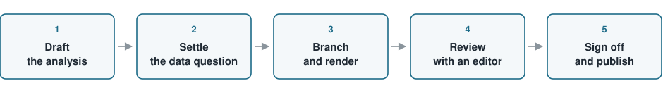

The pages alongside this one are analyses that course participants ran on their own
data. This page is the instruction sheet for adding another: what such a page is
meant to do, what has to be in it, and the steps between a working analysis and
something published on the site.

## Pages built from your own data

The course examples are built to teach. They are small, they are tidy, and the
answer is known in advance. Your data is none of those things, and that is exactly
why a page about it is worth reading. A contributed page shows one of the methods
from the course meeting a real marine dataset, with the compromises that involves:
the records you had to drop, the predictor that turned out to be a proxy for survey
effort, the validation scheme you changed once you thought about how the samples
were collected.

Write it as a short paper for a colleague, not as an assignment. The reader is
another marine scientist, from a different speciality, who knows their own field
well and machine learning hardly at all. They want four things from your page: the
question, the data, what you did, and what you would not claim from the result. The
last of those is the one that makes the page useful. A page that says where the
model failed teaches more than a page that reports a good number.

## The shape of a page

Copy `contributed/_template.qmd`, rename it, and delete the comments as you go. The
skeleton it carries is a suggestion:

| Section | Holds |
| --- | --- |
| The question | What you wanted to find out, and why it matters in your field |
| The data | Source, period, number of observations, what one row is |
| Preparing the data | What you cleaned, dropped or transformed, and why |
| The model | The method, and why that one for this question |
| Results | The figures and the numbers, read out in prose |
| Scope and limits | What you would not claim, and where the model would fail |
| Key points | Three to five bullets a reader should leave with |

Follow your analysis rather than the table. Two pieces are fixed: the data
availability note near the top, and the *Key points* callout at the end. Everything
else moves, merges or splits as the work requires.

Headings are declarative and specific to your page. "Two predictors that turned out
to be one" tells a reader scanning the sidebar what the section says; "Results and
discussion" does not. Aim for 1,000 to 1,800 words plus code. If it runs
substantially longer, it is probably two pages.

## Front matter and file names

Every page opens with complete YAML:

```yaml
---
title: "Predicting otolith age class from shape descriptors"
description: "A random forest applied to 1,240 otolith images from coastal surveys"
author: "Name, Institution"
date: 2026-09-15
categories: [case-study, classification, trees-ensembles]
---
```

The `description` is the sentence on your listing card, so it names the method and
the data in one line. The `categories` start with `case-study` and add the method
tags that genuinely apply, taken from the controlled list in
`.claude/site-structure.md`. Those tags are what pulls your page together with the
course sections on the same method, so an invented tag leaves the page stranded.

Name the file `2026-<author-slug>-<topic>.qmd`, for example
`2026-nakamura-otolith-ageing.qmd`. Hand-made figures go in `contributed/img/`,
prefixed with the same author slug. The listing on the
[contributed pages](index.qmd) index picks up files that start with a year and
sorts them newest first, which is why the year prefix matters.

## Data you can publish, and data you cannot

Marine data is often embargoed, licensed, or covered by a sharing agreement that
was signed by someone else. The default is therefore **not** to commit it, and the
question gets settled before anything is written, not after.

- **If the data can be shared**, put it in `data/`, keep it under 5 MB, and record
  the source, collection period, licence and citation at the top of the page.
- **If it cannot**, the page is still publishable. Build the figures from a small
  synthetic or aggregated stand-in, and say so plainly in the data availability
  callout. Never let a stand-in result read as though it were the real survey.
- **Either way, strip what should not travel**: precise locations of protected or
  commercially valuable species, vessel identifiers, anything personal.

The callout itself is short and unambiguous:

````markdown
::: {.callout-note}
## Data availability
The survey records are held under a data-sharing agreement and are not in this
repository. The figures below use an aggregated stand-in with the same structure.
:::
````

## Code the site can run

Contributed pages are R only. The site's build executes R and nothing else, and the
Python tabs in the course sections are displayed rather than run, so a page whose
results come from Python has no way to produce them here. If your analysis lives in
Python, raise it before you start writing rather than after.

Beyond that, the habits are the ones that make a page reproduce for a stranger:

- `set.seed()` before anything random, in the same chunk as the thing it seeds.
- One hidden `setup` chunk holding every `library()` call and
  `source(here::here("R/theme.R"))`. A chunk that depends on a package loaded
  nowhere on the page renders here and fails for the reader who downloads the
  script.
- Paths through `here::here()`, never relative or absolute.
- Packages through `renv`, never `install.packages()` in a page.
- Fits under about 30 seconds. If one is genuinely slow, run it in a script under
  `R/`, cache the result into `data/`, and have the page read the cache.

At least one figure, and every figure carries `fig-cap` and `fig-alt`. The caption
says what the figure is; the alt text describes what it shows, for a reader who
cannot see it, so the two are not copies of each other. Use colour that survives
greyscale and colour-blind vision: viridis or Okabe–Ito, never red against green for
a two-class contrast.

## From a draft to a published page

::: {.diagram}
{fig-alt="Five boxes joined by arrows: draft the analysis, settle the data question, branch and render, review with an editor, sign off and publish."}
:::

1. **Draft the analysis.** A `.qmd` is ideal. An `.R` script plus notes is fine, and
   gets turned into a page with you.
2. **Settle the data question**, using the rules above, before any data or figure is
   committed.
3. **Branch and render.** Work on `feature/contrib-<author-slug>`, then check it
   builds clean and that the figures read well at page width:

   ```sh
   quarto render contributed/2026-nakamura-otolith-ageing.qmd
   ```

4. **Review with an editor.** Expect edits to code that does not run, to a missing
   seed or a missing `renv` dependency, and to the methodological traps the course
   itself warns about: leakage from a step fitted before the split, random
   cross-validation on spatially autocorrelated data, accuracy reported on a rare
   event, prediction well outside the sampled range. These are raised with you, not
   rewritten behind your back. If you have a reason for the choice, the page is
   published with a note explaining it. Your voice and your scientific judgement
   stay yours; the editing is for reproducibility and consistency.
5. **Sign off and publish.** The page goes into `develop` through a pull request,
   and you see it rendered before it reaches the published site. Nothing is
   published without that.

::: {.callout-tip}
## Key points
- A contributed page is a short paper for a colleague in another speciality: the
  question, the data, the method, and an honest account of the limits.
- Settle what the data permits before anything is committed. A stand-in dataset is
  always allowed, provided the page says that is what it is.
- Start from `contributed/_template.qmd`, keep the data availability note and the
  *Key points* callout, and let your analysis set the rest of the shape.
- Pages are R only, seeded, and built from `here::here()` paths, so that a reader
  who downloads the script gets your numbers back.
- Editing fixes reproducibility and flags known traps; it does not overrule your
  judgement, and you sign the page off before it is published.
:::
