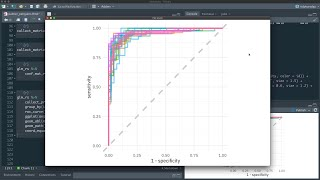

```{r}
#| label: setup
#| include: false
library(tidymodels)
library(tidyverse)
source(here::here("R/theme.R"))
source(here::here("R/data.R"))
```

## One grammar for a hundred models

R has a fitting function for almost every method ever published, and no two of them
agree. `lm()` wants a formula, `glmnet()` wants a matrix, `randomForest()` wants
factors, `xgboost()` wants numbers. Trying a second method therefore means rewriting
the code around it, and that friction is enough to stop most people trying one at all.

tidymodels replaces those interfaces with a single one. This page runs that one shape
through from start to finish, on the survey used everywhere else in the course, so that
the code on later pages reads as a variation rather than as something new. It is an
orientation, not a tutorial in R.



## The idea

Six packages, each owning one stage, loaded together by `library(tidymodels)`:
`rsample` splits the data, `recipes` describes the preprocessing, `parsnip` names the
model, `workflows` binds those two into one object, `tune` searches for settings, and
`yardstick` scores the result.

The part worth understanding before anything else is the middle. A recipe and a model
specification are *descriptions*, not results. Neither touches the data until you call
`fit()`, which is what makes them interchangeable.

::: {.diagram}
{fig-alt="A recipe object, labelled recipes, and a logistic regression specification, labelled parsnip, both feed into a workflow object, labelled workflows, which then goes to fit on the training data and predict on the test data."}
:::

If you also read Python, the same stages carry these names:



## Worked example

We predict whether a benthic species was present at a station, from depth, temperature,
chlorophyll and seabed type.

**Split first, before looking at anything.** `strata` keeps the presence rate the same
in both halves, which matters when one class is much smaller than the other.

```{r}
#| label: split
survey <- load_coastal_survey_clean()

set.seed(1)
split <- initial_split(survey, prop = 0.75, strata = present)
train <- training(split)
test  <- testing(split)

c(training = nrow(train), test = nrow(test))
```

**Describe the preprocessing.** A recipe is a list of instructions attached to a
formula. Chlorophyll has gaps, so we fill them with a median, and seabed type is text,
so it becomes indicator columns.

```{r}
#| label: recipe
rec <- recipe(present ~ depth_m + temperature_c + chlorophyll_mg_m3 + substrate,
              data = train) |>
  step_impute_median(all_numeric_predictors()) |>
  step_dummy(all_nominal_predictors())
```

The median it will use has not been computed yet. When it is, it will be computed from
the training rows alone, which is the whole reason for writing the step down instead of
imputing the column by hand. [Section 2](../chapters/02-marine-data/information-leakage.qmd)
is about what goes wrong when you do it by hand.

**Choose the model, bind it to the recipe, and fit.** `logistic_reg()` carries no data,
only the decision to fit a logistic regression.

```{r}
#| label: fit
fitted <- workflow() |>
  add_recipe(rec) |>
  add_model(logistic_reg()) |>
  fit(train)
```

**Predict on the held-out stations and score.** `augment()` adds the predicted class and
the predicted probabilities as new columns beside the truth, which keeps everything in
one table.

```{r}
#| label: score
scores <- metric_set(roc_auc, accuracy)

augment(fitted, test) |>
  scores(truth = present, estimate = .pred_class, .pred_yes)
```

## One word changed, a better model

The recipe, the split and the scoring all stay as they are. Only the model
specification changes.

```{r}
#| label: fit-forest
set.seed(2)
forest <- workflow() |>
  add_recipe(rec) |>
  add_model(rand_forest(mode = "classification")) |>
  fit(train)

augment(forest, test) |>
  scores(truth = present, estimate = .pred_class, .pred_yes)
```

ROC AUC rises from 0.59 to 0.68. That gap is not an accident of this dataset: abundance
in this survey peaks near 80 m and near 9 °C and falls away on both sides, and a logistic
regression is linear in the log-odds, so it cannot represent a hump. The forest can.
Section 3 explains [how a forest works](../chapters/03-supervised-learning/forests-and-boosting.qmd)
and [compares it with regression models](../chapters/03-supervised-learning/choosing-a-method.qmd)
on the same sites.

The point here is the cost of having asked. Two lines, and nothing else on the page had
to move.

::: {.callout-warning}
## Accuracy of 0.775 is the giveaway, not the result
Presence was recorded at 77.5% of the test stations, so a model that answered "yes"
every time would score 0.775 too. The logistic model did exactly that: its confusion
matrix has an empty absence row. Accuracy equal to the majority-class rate almost always
means the model is doing nothing, which is why the score above is reported next to ROC
AUC rather than alone. See
[classification measures](../chapters/07-validation/classification-metrics.qmd).
:::

## Limits of this tour

**Two models on one split is not a comparison.** A single 75/25 split has enough noise
in it to reverse that ordering. Cross-validation, in
[section 7](../chapters/07-validation/cross-validation.qmd), is what makes the
difference measurable.

**Nothing here was tuned.** Both models ran on defaults. `tune` and the grid search that
goes with it arrive in
[section 5](../chapters/05-generalisation/hyperparameter-selection.qmd).

**Random splitting assumes independent rows.** Survey stations near each other are not
independent, so a random split flatters every model on this page.
[Section 6](../chapters/06-assumptions-limitations/spatial-and-temporal-dependence.qmd)
explains why, and section 7 gives the blocked alternative.

**The syntax is not the skill.** Fitting is the easy part. Nearly everything else in
this course is about whether the number at the end means anything.

::: {.callout-tip}
## Key points
- One shape covers every method: split, recipe, model specification, workflow, fit,
  predict, score.
- A recipe and a model specification compute nothing until `fit()`. That is why they can
  be swapped independently, and why preprocessing learned inside a workflow cannot leak
  the test set.
- Changing method means changing one function call, so there is no excuse for not trying
  a second one.
- `augment()` returns predictions beside the truth in one table, which is the shape
  `yardstick` expects.
- Always score against a baseline. Accuracy equal to the majority-class rate means the
  model may be doing nothing at all.
:::

## Try it yourself

1. Swap `rand_forest()` for `boost_tree(mode = "classification")` and rerun the last
   chunk. How much of the code had to change?
2. Add `salinity_psu` and `season` to the recipe formula. Does either model improve, and
   is the change larger than the difference between the two models?
3. Drop `strata = present` from the split and rerun. How much does the test-set presence
   rate move between seeds?

## Further resources

**Documentation**

- [Get Started](https://www.tidymodels.org/start/), tidymodels. Five articles covering the same ground as this page, at more length.
- [Tidy Modeling with R](https://www.tmwr.org/), Max Kuhn and Julia Silge. The book, free online. [Recipes](https://www.tmwr.org/recipes.html) and [resampling](https://www.tmwr.org/resampling.html) are the two chapters to read first.
- [workflows](https://workflows.tidymodels.org/), tidymodels. What a workflow can hold besides a recipe and a model.

**Video**

::: {.video-list}
- [{.video-thumb fig-alt="Get started with tidymodels and classification of penguin data, on YouTube" loading="lazy"}](https://www.youtube.com/watch?v=z57i2GVcdww)

  [Get started with tidymodels and classification of penguin data](https://www.youtube.com/watch?v=z57i2GVcdww), Julia Silge. The same shape as this page, worked live on a different dataset.

- [{.video-thumb fig-alt="posit::conf(2023) Workshop: Introduction to tidymodels, on YouTube" loading="lazy"}](https://www.youtube.com/watch?v=NTtcTF2tFEA)

  [posit::conf(2023) Workshop: Introduction to tidymodels](https://www.youtube.com/watch?v=NTtcTF2tFEA), Posit PBC. A full workshop recording, for readers who want the long version.
:::
